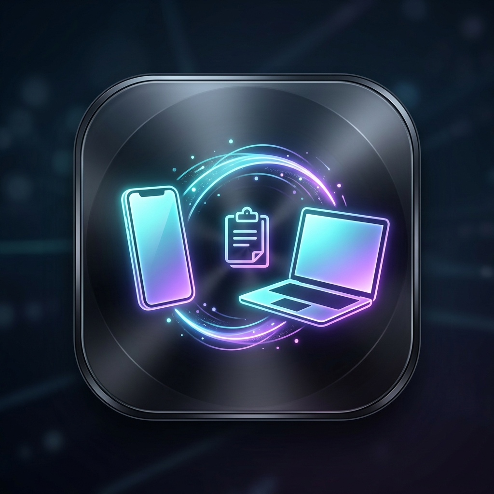
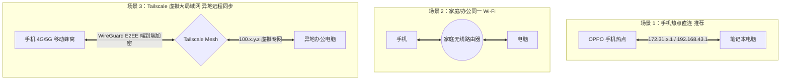

# Agent Phone Toolkit (跨设备剪贴板双向同步与管理套件)

<p align="center">
  
</p>

<p align="center">
  <b>真正免投屏 · 零发热 · 双向毫秒级 · 手机端 0 安装包</b><br>
  专为 Windows 与 Android（实测支持 Android 7 ~ ColorOS 16 / Android 16）打造的高性能跨设备互联神器
</p>

---

## 🌟 为什么选择 Agent Phone Toolkit？

很多用户在使用官方互联套件（如 OPPO 互联、各类手机助手）配合移动热点时，都会遇到以下痛点：
1. **手机严重发热发烫**：官方互联强行推流视频画面，持续占用硬件视频编码器与天线带宽；
2. **手机后台经常被杀**：手机端安装的第三方剪贴板 App 逃不过省电精灵与应用管家的冻结与查杀；
3. **Android 10+ 隐私限制**：普通应用退到后台后，被系统严禁读取监听剪贴板，导致必须切到前台才能同步；
4. **单向同步阉割**：很多简易工具只能“手机同步到电脑”，无法做到“电脑复制实时推送到手机”。

**Agent Phone Toolkit 彻底重构了传输协议，解决了以上所有问题：**

* ⚡ **真正的双向实时同步**：
  * **电脑 $\rightarrow$ 手机**：电脑任意处 `Ctrl+C` 复制，手机搜狗/微信输入法剪贴板、系统剪贴板毫秒级自动接收！
  * **手机 $\rightarrow$ 电脑**：手机长按复制任意文字，电脑直接 `Ctrl+V` 即刻粘贴！
* ❄️ **零发热 / 零视频流（纯控制流协议）**：
  * 直接对接 `scrcpy-server` 底层二进制控制管道（`CONTROL_MSG_TYPE_SET_CLIPBOARD 0x09` 与 `DEVICE_MSG_TYPE_CLIPBOARD 0x00`）。
  * 完全关闭视频与音频推流，手机硬件编码器 0 占用，手机完全不发热。
* 📱 **手机端 0 安装 / 零 APK 负担**：
  * 手机无需安装任何第三方 APK 或常驻应用，不占手机存储空间，没有桌面垃圾图标。
  * 依托 Android 系统原生的 `shell` 用户权限（UID 2000）在内存运行，直接调用底层 `IClipboard` 接口，**永不被 ColorOS 杀后台**，断开即完全释放。
* 🛡️ **开机自启动与完全脱离 AI 独立常驻**：
  * 内置 Windows 注册表 Run 项 + Startup 启动文件夹双重保险。
  * 支持 `--silent` 隐形静默运行，无需开着终端窗口或反重力客户端，电脑开机后自动随系统自启。

---

## 🌐 支持的网络环境与连接拓扑

无论你身处何种网络场景，都能轻松实现跨设备剪切板同步：



### 1. 手机热点直连（强烈推荐 ⭐⭐⭐⭐⭐）
* **场景**：外出办公、图书馆、宿舍等电脑直接连手机热点。
* **特点**：延迟低于 2ms，完全不受外部公共路由器“AP 隔离”限制。程序会自动检测默认网关 IP（如 `172.31.39.190` 或 `192.168.43.1`）秒级重连。

### 2. 同一 Wi-Fi 局域网（⭐⭐⭐⭐）
* **场景**：手机和电脑都连接同一个家庭或办公室 Wi-Fi。
* **特点**：只要路由器没有开启“AP 隔离/客户端隔离”，两端在同一子网下即可畅通同步。

### 3. Tailscale 虚拟网（跨网段 / 异地安全同步 ⭐⭐⭐⭐⭐）
* **场景**：电脑在家里开着，手机在外面用 5G 数据流量，或者两台设备连着不同的 Wi-Fi。
* **安全性与原理**：
  * 手机安装 Tailscale 客户端，电脑安装 Tailscale，二者登录同一个 Tailnet。
  * 电脑只需执行 `adb connect <手机Tailscale_100_IP>:5555` 即可穿透同步。
  * **数据安全**：Tailscale 基于 **WireGuard 协议**，所有剪贴板流量均在两端本地进行 **端到端加密（E2EE）**。Tailscale 服务器仅负责节点发现与 NAT 打洞（STUN/ICE），**绝无能力解密或查看你的剪贴板内容**，私密安全等级极高。

---

## 🧰 所需工具与环境准备

### 电脑端（Windows）
1. **Windows 10 / 11 (64位)**
2. **Android 调试桥（ADB）**：
   * 下载官方 Google [Platform Tools for Windows](https://developer.android.com/tools/releases/platform-tools) 并解压。
   * 确保 `adb.exe` 处于系统环境变量 PATH 中，或放在常用目录下。

### 手机端（Android）
1. **Android 系统**：Android 7.0 及以上（实测完美兼容 ColorOS 16 / Android 16）。
2. **手机开启【USB 调试】**：
   * 打开手机 **设置 -> 关于本机 -> 版本信息 -> 连续点击“版本号”5次** 开启开发者选项。
   * 进入 **设置 -> 其他设置 / 系统设置 -> 开发者选项**：
     * 开启 **“USB 调试”**（必选）
     * 开启 **“禁止权限监控”**（ColorOS / OPPO 用户必选，防止后台权限弹窗阻断）
   * 首次连接提示：手机屏幕弹出【允许 USB 调试吗？】时，请勾选【始终允许来自此计算机的调试】并点击【确定】。

> [!TIP]
> **常见疑问 1：为什么开热点时不需要（也开不了）系统设置里的“无线调试”？**  
> Android 11+ 系统设置里的“无线调试”开关限制必须连着 Wi-Fi 才能打开。但只要开启了基本的**【USB 调试】**，Android 底层的调试守护服务（`adbd`）就会自动在热点虚拟网卡（`172.31.x.1:5555`）上监听通信。因此开热点使用时，无需理会系统那个“无线调试”开关！

> [!TIP]
> **常见疑问 2：不用流量、只用 Wi-Fi 的用户怎么用？**  
> - **方案 A（家庭/公司 Wi-Fi）**：手机和电脑连接同一个 Wi-Fi 即可，数据在路由器内网毫秒级直传。
> - **方案 B（纯热点免流量）**：手机开启个人热点，**即使关闭手机蜂窝移动网络（0 流量）**，电脑连接热点后依然可以正常双向同步剪切板，完全不消耗任何手机话费流量！

3. **手机端应用**：**0 安装！完全不需要安装任何 APK！**

---

## 🚀 下载与安装

### 方式 1：下载 GitHub Release 安装包（小白推荐）
1. 前往本仓库 [Releases 发布页面](https://github.com/zou-handy/agent-phone-toolkit/releases) 下载最新版本的 `AgentPhoneToolkit-v1.0.0-windows.zip`。
2. 解压压缩包，右键以管理员身份运行 **`install.bat`**。
3. 安装程序将自动：
   * 拷贝程序到 `%LOCALAPPDATA%\Programs\AgentPhoneToolkit\`；
   * 创建带精美图标的 **桌面快捷方式**；
   * 注册 Windows 开机自启服务；
   * 在后台立即静默启动服务。

### 方式 2：命令行自编译与自安装
如果你已克隆源码：
```powershell
# 1. 运行一键安装
python clipboard_sync.py --install

# 2. 或直接运行编译好的二进制
./clipboard_sync.exe --silent
```

---

## ⚙️ 命令行参数说明

`clipboard_sync.exe` 支持以下命令行参数：

| 参数 | 说明 |
| :--- | :--- |
| *(无参数)* | 前台控制台模式启动，实时打印每次双向同步的字符数与时间戳（调试用） |
| `--silent` / `-s` | 隐形后台模式，隐藏 Windows 终端黑框，无感常驻 |
| `--install` / `-i` | 一键安装到系统应用程序目录、生成桌面图标并配置开机自启 |
| `--uninstall` / `-u` | 彻底清理系统注册表与启动项，并停止运行 |
| `--enable-autostart` | 仅注册 Windows 开机自启（注册表 Run 项 + Startup 启动文件夹） |
| `--disable-autostart` | 仅移除 Windows 开机自启 |

---

## 🔒 隐私与安全性保障

* **纯本地通信**：所有数据均在手机与电脑间的局域网热点/内网直接经由 Socket 传输，不经过任何第三方云端中转服务器。
* **零明文留存**：程序内部采用纯内存比对防回音缓存，不写任何历史剪贴板数据库到磁盘。
* **开源透明**：完整核心代码与协议报文仅一个 Python 源码文件，无任何晦涩混淆代码。

---

## 📄 开源许可证

本项目基于 [Apache License 2.0](LICENSE) 开源。
欢迎提出 Issue 与 PR！
